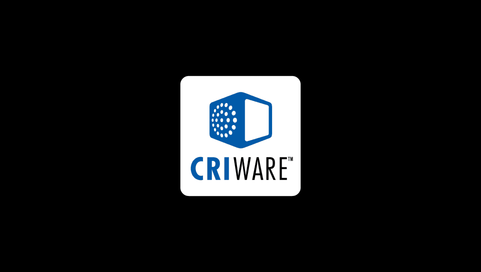
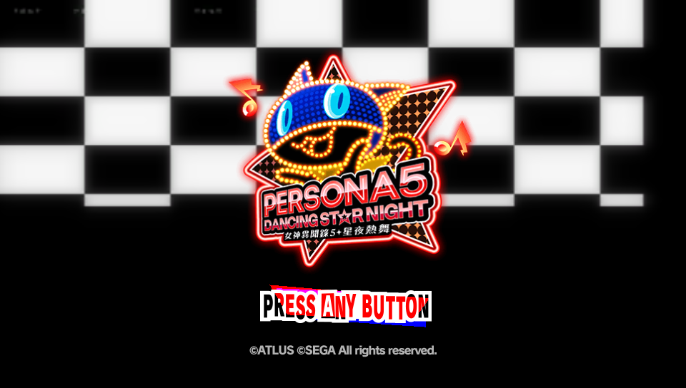
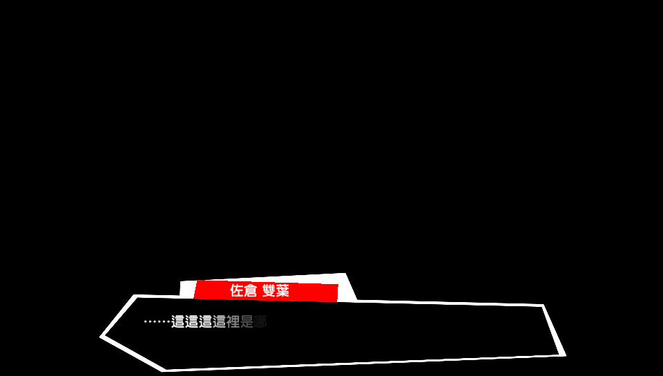
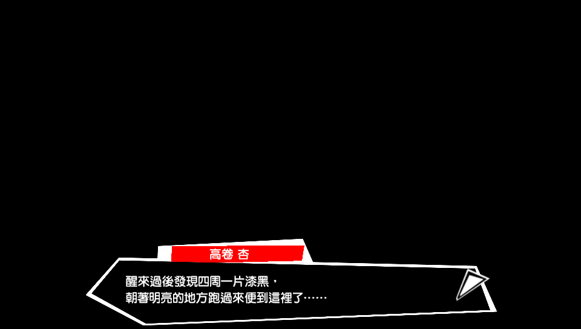
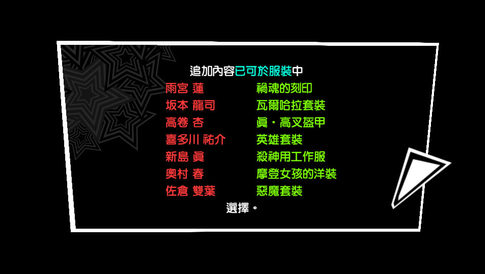

# P5D-PC — PS Vita『Persona 5: Dancing in Starlight』(PCSH10109) PC 原生移植

> **目标**：把玩家自备的 PS Vita 版 P5D（PCSH10109, 1.00）**原版游戏二进制一字不改**地在 PC（后续扩展到手机）上运行：
> CPU 用 **AOT 静态重编译**（原版 ARM/Thumb → x86-64 原生执行，解释器 fallback），系统 API 由本地兼容层（HLE）
> 接管，图形按 [nativ](https://github.com/TheLostPantheon/nativ) 架构用 **Sony 自己的 libgxm/libgpu_es4**（从玩家固件 AOT 重编译）
> 输出到 **Vulkan**，最终串联 `S0_LOGO → S1_TITLE → S2_MENU → S3_SELECT → S4_GAME → RESULT` 全流程，
> **画面/布局/数值由原版游戏代码自己绘制**。

> 仓库：<https://github.com/kaimeng114514/PSV-P5D-Recomp-port-PC> · 许可：GPL-2（见 [LICENSE](LICENSE) / [NOTICE.md](NOTICE.md)）
> 本仓库**不包含任何游戏文件、游戏密钥、固件或游戏重编译产物**；玩家必须使用自己合法持有的游戏数据。
> 详见 [docs/RELEASE_COMPLIANCE.md](docs/RELEASE_COMPLIANCE.md)。

---

## 🔥 截图：全部由原版 P5D 代码在本项目的移植运行时里绘制

> 截图取自游戏自己的帧缓冲（见下文“验证链”），不是渲染示意图，也不是窗口截图。
> 游戏画面版权归 **ATLUS / SEGA**，此处仅作逆向工程/移植进度说明。

### S0_LOGO：原版开场 logo 序列（ATLUS → P-STUDIO → CRIWARE）

| ATLUS | P-STUDIO | CRIWARE |
|---|---|---|
|  |  |  |

### S1_TITLE：标题画面（原版代码绘制）



`PERSONA5 DANCING STAR NIGHT` 霓虹 logo、`PRESS ANY BUTTON`、`©ATLUS ©SEGA All rights reserved.`
全部是游戏自己的 sprite/UI 系统经 GXM 管线绘制（对应游戏数据 `title/P5/title.spr6` 中的
`title`/`title02`/`logo`/`press` sprite）。

### 标题 → 剧情 的实时过渡动画


标题界面在按下确认后播放镜头形变/拉远过渡（frame 6910），随后进入开场剧情——逐帧动画证明是实时游戏渲染。

### 开场剧情对话（原版文本/UI 系统）

| 佐倉 双葉 | 高卷 杏 |
|---|---|
|  |  |

白色描边对话框、红色名牌、中文文本、鼠标光标均由游戏自己的 UI/字体系统绘制。

### 更早的进度：DLC 服装通知（游戏自绘；我们修复 P8/P4 调色板纹理后）



---

## 如何确认“画面是游戏自己画的”？——路线自检（2026-11-05）

1. **原版二进制未改**：`app0/eboot.bin.elf` 的 SHA-256 = `f823faaeab2b7234e3f47392ba83728b6340aa30f291f70b5b46b617b4ddeb23`（6,279,728 B），
   与 pack `[versions."1.00"] sha256` 一致、构建时校验；AOT 重编译产物只在本机生成，仓库不含。
2. **截图取自游戏帧缓冲**：`runtime/gfx/gfx_soft.c` 的 `shot()` 直接从 **guest 显示内存**
   (`RD32(base + …)`) 写 PPM；GPU 后端先把 guest libgxm 捕获的 GXM 绘制重放为 Vulkan，再同步回 guest 内存。
   不是窗口截图，没有 UI overlay，也没有把任何图片 blit 到画面上。
3. **host 不含游戏内容**：`game_host.exe` 中 `PRESS ANY BUTTON` / `PressAny` / `PERSONA5` / `DANCING` /
   `ATLUS` / `title.spr` / `title_bg` / `NewGame` 出现次数**全为 0**；`packs/PCSH10109/hooks.c`、`pack.toml` 同样没有。
4. **画面元素来自游戏资源（已做像素级提取验证）**：从玩家数据 `title/P5/title.spr6` 中解析出 2 张内嵌
   color-mapped TGA：`title`（512×512，P5D 霓虹 logo）+ `title02`（256×64，`PRESS ANY BUTTON` 白字），
   与屏幕上的 logo/按钮**完全一致**（本地提取对比，原始资源不入库）；另 `title/title.spr4` 含
   `PressAny_off/on`、`NewGame_off/on`、`LoadGame_off/on`、`title_bg` —— 标题 UI 就是这些游戏 sprite
   经游戏自己的 GXM 管线画出来的。
5. **实时游戏状态机驱动**：hook 探针挂在 **guest 函数** `0x81198172`（title sequence）、
   `0x81193fbe`（titleDraw）、`0x81193a90`（title 异步任务）上，观察到状态
   `0→1→3→4→…→7` 与标题出现同帧对齐；标题出现后逐帧出现元素，frame 6910 出现镜头形变过渡，
   之后按输入进入剧情对话（双叶→杏）——不是静态注入图。
6. **渲染数据全部为 guest 数据**：Vulkan 绘制使用的 GXM shader 位于 guest 地址
   （如 `0x8153…`、libgxm `0x1102b…`），纹理是 guest 内存里的游戏纹理
   （如 P8 `0x95001000` 调色板纹理 @ `0x2069b280`）；host 只做翻译/执行。
7. **与历史参考对比**：S0 三个 logo 的像素统计与参考帧一致（§18.4883：ATLUS nz=`35915`、
   CRIWARE nz=`57122` 完全相同，包围盒相同）。

### 诚实说明：当前限制

- **标题/剧情截图启用了诊断开关 `RECOMP_P5D_FORCEMOVIE=1`（默认关闭）**：title 背景影片
  `movie/c_p5d001.usm` 的 USM/CRI 解码路径尚未修好，游戏会卡在“等影片就绪”的门上；强制该门后
  **UI/文字/动画仍全部由游戏自己绘制**，但影片背景（红天/城市/彩带）还缺失，所以画面尚未 100% 与原版一致。
  这是下一步工作，不是“假画面”。
- S0_LOGO 截图**不需要任何强制开关**，是正常流程原样渲染的。
- 目前标题/剧情阶段帧耗时异常（约 1.4 s/帧），待优化。

---

## 当前状态（2026-11-05，里程碑 M1345 / round 1315）

| 模块 | 状态 | 说明 |
|---|---|---|
| 原版 eboot/SELF 原样加载 | ✅ | `eboot_origin.bin.elf`（无 MaiDump 依赖）SHA-256 校验通过 |
| AOT 静态重编译（ARM/Thumb→x86-64） | ✅ | 原版 14,929 个函数重编译；未支持指令补齐中 |
| Sony 用户库重编译（libgxm/libc/libfios2…） | ✅ | 按 nativ 架构从玩家固件重编译，替代手写 GXM HLE |
| GXM → Vulkan 渲染 | ✅ | 原版 shader/纹理/绘制状态动态翻译；S0/S1/剧情画面正常 |
| **S0_LOGO** | ✅ | ATLUS → P-STUDIO → CRIWARE，与参考图定量一致 |
| **S1_TITLE** | ✅（影片背景待补） | 标题画面/UI/动画由原版代码绘制；USM 背景影片解码仍缺 |
| 开场剧情对话 | ✅（背景待补） | 原版文本/UI/输入推进正常 |
| 影片解码（USM/CRI） | ❌ | `movie/c_p5d001.usm` 设备状态停在 7，USM 数据/解码路径待打通 |
| S2_MENU → S3_SELECT → S4_GAME → RESULT | 未达 | 下一步推进 |
| 性能 | 部分 | 标题/剧情阶段存在 ~1.4 s/帧 异常，待查 |

更完整、可复现的证据链见 **[docs/P5D_MASTER.md](docs/P5D_MASTER.md)**（权威开发日志，含每个里程碑的
ANTI-FORGETTING 记录、命令、日志与截图路径）。

---

## 架构（当前实现）

```
玩家自备 P5D 数据（eboot + data.cpk/vita.cpk）+ PS Vita 固件（自备）
        │
        ▼
  nativ 架构工具链（本机）
    ├─ analyze/recompile：原版 eboot → x86-64 C 代码（AOT，本机生成）
    ├─ analyze/recompile：Sony libgxm/libc/libfios2/libgpu_es4（固件）→ x86-64
    └─ build：链接 内核/图形/输入/音频/视频 HLE 层 → game_host.exe
        │
        ▼
  运行时 HLE：线程/同步、内存、文件（app0→本地目录、CPK）、输入、音频、视频、显示
        │
        ▼
  GXM 状态观察（libgxm_es4 原生运行）→ API 中立 GfxDraw
        │
        ▼
  Vulkan GPU 后端（SDL3 GPU）→ 交换链/玩家窗口
```

> 当前工程基于 GPL-2 的 [nativ](https://github.com/TheLostPantheon/nativ) 架构与部分 GPL-2 参考
> （Vita3K 等）。归属说明见 [NOTICE.md](NOTICE.md) / [THIRD_PARTY_NOTICES.md](THIRD_PARTY_NOTICES.md)。

## 开发期运行（需要玩家自备游戏与固件）

> 目前仍是**开发/验证形态**（`game_host.exe` + 玩家数据），一键发布版/手机移植在后续里程碑完成。

1. 自备 PS Vita 3.74 固件（从自己的设备提取），解密到 nativ 工具链的 `firmware/3.74`。
2. 自备合法持有的 P5D（PCSH10109 1.00）数据：`eboot_origin.bin`、`data.cpk`、`vita.cpk` 等。
3. 使用 nativ 流水线：`add → import → analyze → recompile → build → test`（细节与命令见
   [docs/NATIV_REFERENCE.md](docs/NATIV_REFERENCE.md) 与 [docs/P5D_MASTER.md](docs/P5D_MASTER.md)）。
4. 标题/剧情阶段（影片背景未修好前）需要 `RECOMP_P5D_FORCEMOVIE=1` 诊断开关才能越过 USM 门。

## 发布合规与版权

- 发布树红线（不含游戏可执行码/资源/着色器衍生数据/密钥固件）见
  [docs/RELEASE_COMPLIANCE.md](docs/RELEASE_COMPLIANCE.md)。
- `docs/screenshots/` 仅为开发进度截图（由本项目运行时输出、版权归 ATLUS/SEGA，可应要求移除）；
  `tools/release_audit.py` 对其显式允许，其余 `.png/.bmp` 仍按红线拒绝。
- 本仓库以 **GPL-2** 发布。

## 致谢

- [Project Nativ](https://github.com/TheLostPantheon/nativ)（GPL-2）：AOT 重编译 + Sony 用户库重编译 + GPU 抽象架构
- [Vita3K](https://github.com/Vita3K/Vita3K)（GPL-2）：GXM/AVC/文件系统语义参考
- 以及所有 PS Vita 逆向工程社区的资料与工具
