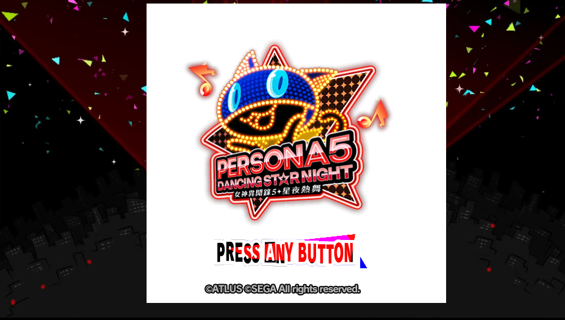
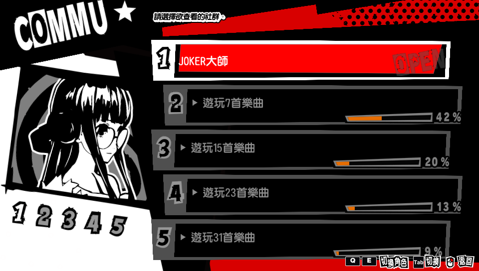
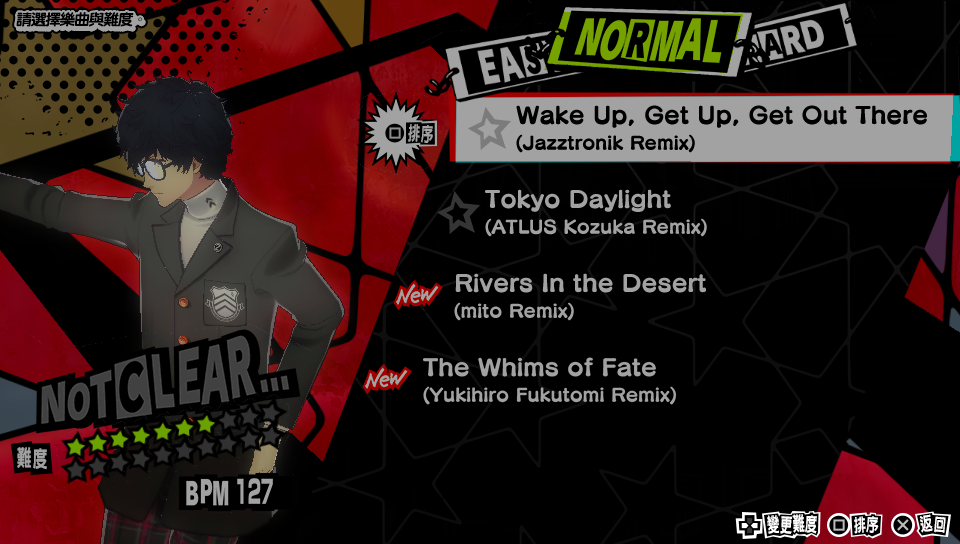
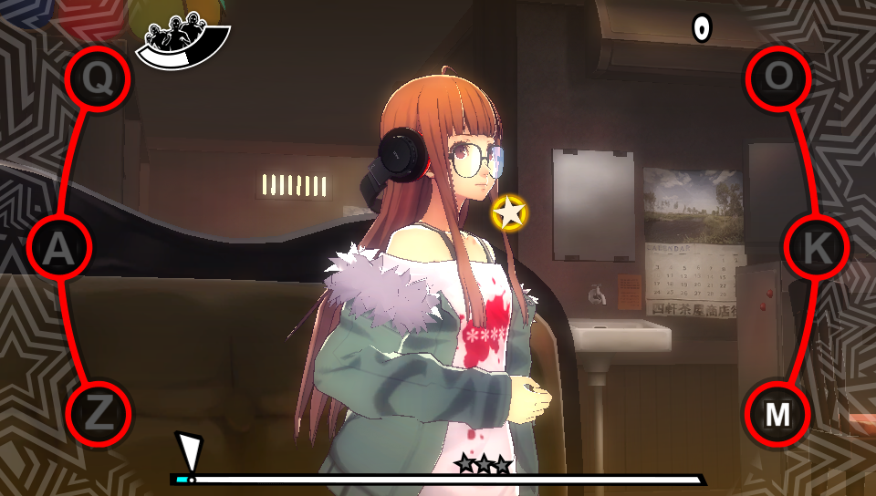
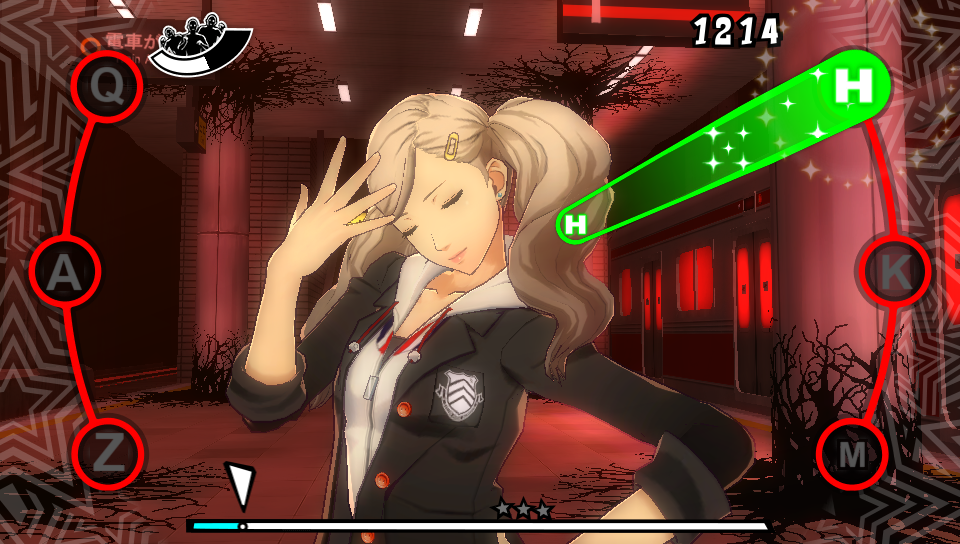
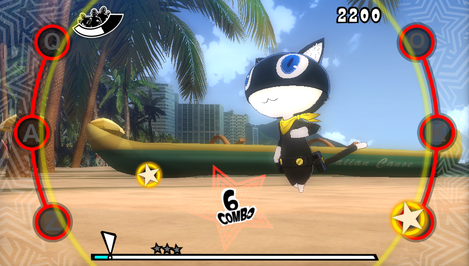
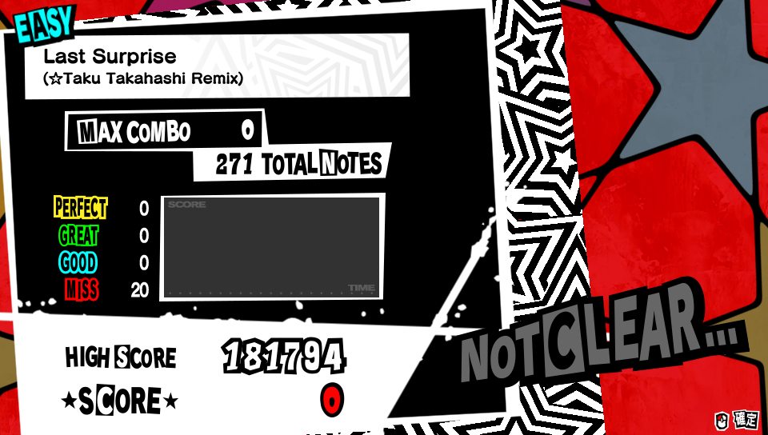
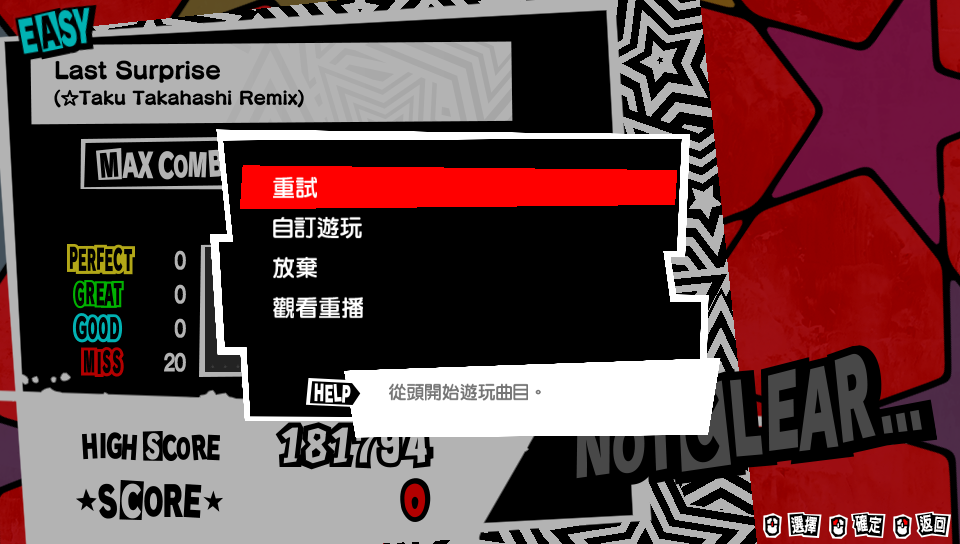
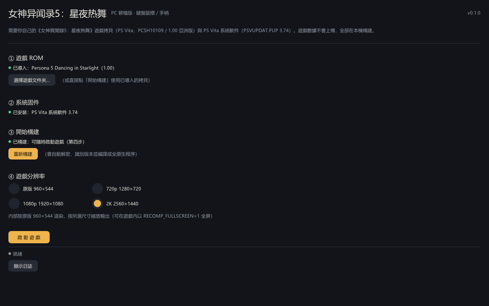
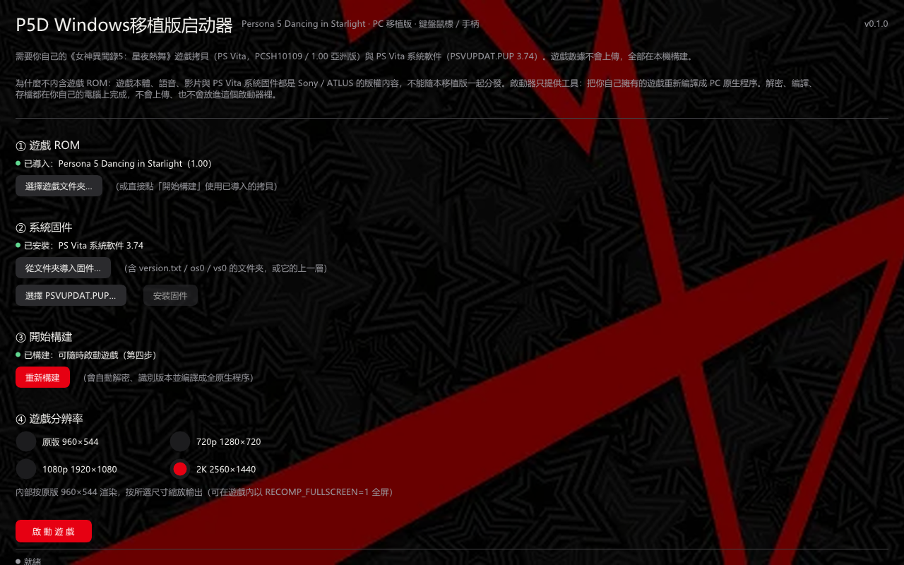

# P5D-PC — PS Vita『Persona 5: Dancing in Starlight』(PCSH10109) PC 原生移植

> **目标**：把玩家自备的 PS Vita 版 P5D（PCSH10109, 1.00）**原版游戏二进制一字不改**地在 PC 上运行：
> CPU 用 **AOT 静态重编译**（原版 ARM/Thumb → x86-64 原生执行，解释器 fallback），系统 API 由本地兼容层（HLE）
> 接管（文件/存档、内存、线程、GXM→Vulkan、音频、输入、视频解码），最终串联
> `S0_LOGO → S1_TITLE → S2_MENU → S3_SELECT → S4_GAME → RESULT` 全流程，
> **画面/布局/数值由原版游戏代码自己绘制**。

> 仓库：<https://github.com/kaimeng114514/PSV-P5D-Recomp-port-PC> · 许可：GPL-2（见 [LICENSE](LICENSE) / [NOTICE.md](NOTICE.md)）
> 本仓库**不包含任何游戏文件、游戏密钥、固件或游戏重编译产物**；玩家必须使用自己合法持有的游戏数据。
> 详见 [docs/RELEASE_COMPLIANCE.md](docs/RELEASE_COMPLIANCE.md)。

---

## 🚀 快速开始（单文件启动器）

下载/拿到 **`P5D Windows移植版启动器.exe`**（约 300 MB，自解压）后：

1. **双击运行**。首次会解包运行时（~1 分钟，黑底进度条），然后出现启动器。
2. **游戏 ROM**：选择自己的游戏文件夹（包含 `eboot.bin` 与 `data/`；MaiDump 格式也可）。
3. **系统固件**：选择 `PSVUPDAT.PUP` 3.74，或已解密的固件文件夹（`version.txt`、`os0/`、`vs0/`）。
4. **开始构建**：依次解密 → 分析 → 重编译 → 编译（**首次 10–30 分钟**，启动器显示真实百分比进度；之后启动秒进）。
5. **分辨率**（「畫質選項」頁）：原版 960×544 / 720p / 1080p / 2K 2560×1440 / **4K 3840×2160**。选择会同时决定**内部渲染倍率**
   （4K=4x、2K=3x、1080p=2x），原版 960×544 的布局/数值不变，只是按倍率提升渲染精度；显示器小于所选分辨率时输出会自动
   限制为桌面尺寸（2K 屏上选 4K = 4x 超采样，画面不会超出屏幕）。
6. **帧率**（「畫質選項」頁）：30 帧（原版节奏）/ 60 帧（舞池 60 帧；标题/菜单保持原版 30 帧节奏，不会加速——舞池 60 帧已实测：时间轴按真实时间推进、无倍速）。
7. **画面帧率显示**（「主頁」）：勾选后在画面左上角显示实时帧率。第一行是 `FPS 30.0 FRAME 33.3MS DISP 48`——**FPS 是游戏真实渲染帧数，DISP 是实测「游戏窗口每秒真正显示了多少张不同画面」**（由屏幕采集测量，包含 NVIDIA 驱动 AI 插帧生成的帧；30 帧设定约 48–56、60 帧设定约 107，上限为显示器刷新率）。没有估算值。
8. **AI 插帧（可选，已修复）**：「畫質選項」頁的 **AI 插帧** 会检测显卡/驱动并显示游戏程序路径；把该路径加到 NVIDIA App
   （图形 → 程式设定 → 添加程序）→ 驱动程式设定 → **AI 插帧**（英文 Smooth Motion）= 开。这是 NVIDIA 驱动级 AI 插帧
   （RTX 40/50；本移植是 Vulkan 程序），不是 DLSS 帧生成。
   **NVIDIA App 会把该程序的驱动配置条目写成错误路径（实测），导致插帧不生效；启动器在每次启动游戏前会通过 NVAPI
   自动修复这个条目**（面板会显示「驱动档案」状态）。修复后用外部截屏探针实测：30 帧设定 **29.8 → 56.0 张/秒**、
   60 帧设定约 **107 张/秒**（受 165Hz 面板上限），即 AI 插帧真实生效；游戏节奏/音乐/判定仍是真实 30/60。
   「启用 AI 插帧支援（30 帧设定也有效）」这个选项决定呈现节奏（只送真实帧，便于驱动插帧）；NVIDIA 覆盖层显示插帧
   后帧率，游戏内 F1 显示的仍是真实渲染 30/60。
9. **启动游戏**（「主頁」底部按钮）。

启动器主界面分两个标签页：**主頁**（游戏 ROM / 系统固件 / 开始构建 / 画面帧率显示 / 启动游戏）与 **畫質選項**（分辨率 / 帧率 / AI 插帧）。

所有构建都在你自己的电脑上完成，不上传任何数据。游戏数据与存档保存在
`%LOCALAPPDATA%\P5D-Port\P5D\library`；共享设置（分辨率倍率/全屏/帧率等）在
`%APPDATA%\P5D-Port\P5D\settings.ini`。

> **更新启动器后**：启动器会自动发现构建过期并在下次启动时**重建一次**（会显示进度条），之后恢复秒进。

## 📦 源码

- **源码快照**：[`src/`](src/) —— 移植工程源码（对应提交 `6dd5ab9`，405 个文件，约 20 MB；含 pipeline / recompiler /
  runtime / decrypt / packs / third_party / launcher / dev）。即使本地工程被删除，也可以从本仓库恢复并重新构建。
- 仓库**不含**游戏数据、固件、解密产物或工具链二进制；这些由玩家自备。

### 键盘操作

| 场景 | 按键 |
|---|---|
| 菜单通用 | 方向键移动，滚轮=列表上下，左键=确认，右键=返回；Enter/空格=确认，Backspace=返回，Esc=暂停 |
| 社群界面（角色列表/剧情列表） | **Q/E = L/R 肩键**（切换角色等） |
| 选歌界面 / 设置页 | **Q/E = 十字键左右**（切难度/改数值） |
| 舞池 | **Q/A/Z** = 上/左/下，**D** = 右；**O/K/M** = △/○/×，**J** = □；**Space** = 刮盘；**Esc** = 暂停 |
| 辅助 | **F1** 显示状态；**F11** 重新加载 `input.ini`；**F3** 切换 Q/E 模式（见下） |
| COLLECTION 观赏模式（角色 → 服装 → Enter） | **WASD = 左摇杆（移动）**，**方向键 = 右摇杆（旋转）**，**鼠标滚轮 = 缩放**，**Alt = 重置**；Enter = 开始/退出观赏，Ctrl = △（随机服装） |

> **Q/E 兜底**：如果某个界面 Q/E 映射不符合预期，按 **F3** 循环切换 Q/E 模式
> （`自动` → `L/R 肩键` → `D-pad 左右`），屏幕会提示并记住选择。

**手柄**：即插即用；使用手柄时游戏内提示图标会恢复原版手柄键帽。

---

## 🖼️ 截图：全部由原版 P5D 代码在本项目的移植运行时里绘制

> 截图取自游戏自己的帧缓冲（见下文"验证链"），不是渲染示意图，也不是窗口截图（启动器截图除外）。
> 游戏画面版权归 **ATLUS / SEGA**，此处仅作逆向工程/移植进度说明。

### S0_LOGO：原版开场 logo 序列

| ATLUS | P-STUDIO | CRIWARE |
|---|---|---|
|  |  |  |

### S1_TITLE：标题画面 + USM 影片背景

| 标题画面 | USM 影片背景 | 标题→剧情过渡 |
|---|---|---|
|  |  |  |

### S2_MENU / S3_SELECT：主菜单与选歌

| 主菜单（角色列表/社群） | 选歌界面 |
|---|---|
|  |  |

### S4_GAME：舞池

| 舞池舞台 | 键位图标 + 判定 | 六键字母 |
|---|---|---|
|  |  |  |

### RESULT：结算

| 记分动画（tally） | 4 行结果菜单 |
|---|---|
|  |  |

### 启动器

| 启动器主界面 | P5 主题 |
|---|---|
|  |  |
|  | |

---

## 与 Vita3K 模拟器的区别

本项目不是模拟器，而是**把原版 P5D 的 ARM 代码静态重编译（AOT）成 x86-64 原生程序**，Sony 的系统库也从固件重编译成本地代码、由本地兼容层（HLE）接管。两者的定位与实现不同：

| 项目 | 本项目（P5D PC 原生移植） | Vita3K（PS Vita 模拟器） |
|---|---|---|
| 运行方式 | 原版 ARM 代码 **AOT 静态重编译**为原生 x86-64 程序；系统库重编译 + HLE 接管文件/内存/线程/GXM/音频/输入/视频 | **模拟器**：软件模拟 Vita 的 CPU/GPU/系统，在模拟环境里运行原版程序 |
| 执行开销 | 游戏逻辑直接跑在你的 CPU 上，没有逐指令模拟/翻译循环（首次构建后启动即原生执行） | 需要模拟 CPU 与 GPU，指令与状态翻译有持续开销 |
| 目标 | **只针对 P5D（PCSH10109 1.00）**：为这一款游戏做键鼠、分辨率、镜头等适配 | 通用模拟器：面向大量 PSV 游戏，不做单游戏界面/输入适配 |
| 输入 | 全界面 PC 键鼠映射（主菜单/选歌/打歌/暂停/设置/社群/结算/COLLECTION 观赏），游戏内提示图标替换为 PC 键位；手柄即插即用 | 以模拟手柄/触摸为主；键鼠映射是通用方案，不针对本作界面设计 |
| 画面/数值 | 原版游戏代码自己绘制（HLE 层不含游戏画面内容）；可选 960×544/720p/1080p/2K，内部渲染倍率 1x–3x，原版布局/数值不变 | 原版游戏在模拟器中绘制；也有分辨率/渲染增强选项 |
| 使用流程 | 需要**首次在本机构建**（解密 → 分析 → 重编译 → 编译，约 10–30 分钟），之后原生启动、秒进 | 安装固件后直接加载游戏，无需构建；但每次运行都经过模拟 |
| 存档/数据 | 构建库与存档由本项目管理（`%LOCALAPPDATA%\P5D-Port\P5D`），与模拟器存档不互通 | 使用 Vita3K 自己的模拟存储/存档目录 |
| 依赖 | 构建出的是独立 Windows 原生程序，不依赖模拟器 | 依赖 Vita3K 程序与固件 |
| 许可/来源 | 基于 [nativ](https://github.com/TheLostPantheon/nativ)（GPL-2）架构的 P5D 专用移植 | 独立的开源模拟器项目 |

补充说明：

- 两者都要求玩家**自备游戏拷贝与 PS Vita 3.74 固件**，仓库与发布物不含游戏数据；
- **存档不互通**：本移植版存档在 `%LOCALAPPDATA%\P5D-Port\P5D\library`，Vita3K 的存档在其自己的用户目录，迁移需要额外工具（暂未提供）；
- 本项目**不能**运行其它 PSV 游戏，也不支持 P5D 的其它版本/区域；需要通用模拟请使用 Vita3K；
- 两者的画面都是原版游戏代码绘制，区别在"如何去执行原版代码"：本项目是重编译后的原生执行，Vita3K 是运行时的模拟执行。

---

## 当前状态（2026-11-10，里程碑 M1539）

| 模块 | 状态 | 说明 |
|---|---|---|
| 原版 eboot/SELF 原样加载 | ✅ | `eboot.bin.elf` SHA-256 校验通过，不修改二进制 |
| AOT 静态重编译（ARM/Thumb→x86-64）+解释器 fallback | ✅ | 原版函数全量重编译，未支持指令走 fallback |
| Sony 用户库重编译（libgxm/libc/libfios2…） | ✅ | 按 nativ 架构从玩家固件重编译 |
| GXM → Vulkan 渲染 | ✅ | 原版 shader/纹理/绘制状态动态翻译 |
| 影片解码（USM/CRI） | ✅ | HLE FFmpeg 解码 → NV12 → 原版 libgxm blit 绘制 |
| **S0_LOGO** | ✅ | ATLUS → P-STUDIO → CRIWARE，与参考帧定量一致 |
| **S1_TITLE** | ✅ | 标题画面/UI/动画 + USM 影片背景 |
| **S2_MENU** | ✅ | 主菜单/社群/COLLECTION/CONFIG/SYSTEM 子菜单 |
| **S3_SELECT** | ✅ | 选歌列表（难度选项卡/排序/滚轮）、服装界面 |
| **S4_GAME** | ✅ | 舞池六键/刮盘/暂停/剧情对话 |
| **RESULT** | ✅ | 记分动画（tally）与 4 行结果菜单（滚轮/点击/重试） |
| 分辨率 | ✅ | 960×544 / 720p / 1080p / 2K；内部倍率 1x–3x，原版布局不变 |
| 输入映射 | ✅ | 菜单/选歌/社群/设置按界面切换 Q/E 语义（F3 兜底）；手柄即插即用 |
| 键鼠适配（全界面） | ✅ | 主菜单/选歌/打歌/暂停/设置/社群/剧情/结算/COLLECTION 观赏；Q/E 按界面自动切换（F3 兜底） |
| 左摇杆（WASD 移动） | ✅ | 修复游戏输入层未发布左摇杆数据的根因；WASD=左摇杆、方向键=右摇杆、滚轮=缩放、Alt=重置 |
| 启动器“启动游戏” | ✅ | 修复最小构建宿主（`game_host_min.exe`）识别，构建完成后按钮可点 |
| 构建体验 | ✅ | 启动器真实构建进度百分比 + 首次构建时长提示 |
| 手柄模式实测 | ⏳ | 需要实物手柄做插拔/键帽/结算回归（待玩家反馈） |
| 性能 | 部分 | 已可完整游玩；长时间舞蹈/结算的帧率优化仍在进行 |

更完整、可复现的证据链见 **[docs/P5D_MASTER.md](docs/P5D_MASTER.md)**（权威开发日志，含每个里程碑的
ANTI-FORGETTING 记录、命令、日志与截图路径）。

---

## 架构（当前实现）

```
玩家自备 P5D 数据（eboot + data.cpk/vita.cpk）+ PS Vita 固件（自备）
        │
        ▼
  nativ 架构工具链（本机）
    ├─ analyze/recompile：原版 eboot → x86-64 C 代码（AOT，本机生成）
    ├─ analyze/recompile：Sony libgxm/libc/libfios2/libgpu_es4（固件）→ x86-64
    └─ build：链接 内核/图形/输入/音频/视频 HLE 层 → game_host.exe
        │
        ▼
  运行时 HLE：线程/同步、内存、文件（app0→本地目录、CPK）、输入、音频、视频、显示
        │
        ▼
  GXM 状态观察（libgxm_es4 原生运行）→ API 中立 GfxDraw
        │
        ▼
  Vulkan GPU 后端（SDL3 GPU）→ 交换链/玩家窗口
```

> 当前工程基于 GPL-2 的 [nativ](https://github.com/TheLostPantheon/nativ) 架构与部分 GPL-2 参考
> （Vita3K 等）。归属说明见 [NOTICE.md](NOTICE.md) / [THIRD_PARTY_NOTICES.md](THIRD_PARTY_NOTICES.md)。

## 发布合规与版权

- 发布树红线（不含游戏可执行码/资源/着色器衍生数据/密钥固件）见
  [docs/RELEASE_COMPLIANCE.md](docs/RELEASE_COMPLIANCE.md)。
- `docs/screenshots/` 仅为开发进度截图（由本项目运行时输出、版权归 ATLUS/SEGA，可应要求移除）；
  `tools/release_audit.py` 对其显式允许，其余 `.png/.bmp` 仍按红线拒绝。
- 本仓库以 **GPL-2** 发布。

## 测试人员致谢

v0.1.0 的键鼠适配、界面键位与构建流程能走到今天，离不开参与测试的玩家朋友们。特别感谢以下测试人员（按提供顺序）：

| 测试人员 | 主页 |
|---|---|
| **lris舒** | <https://b23.tv/gu15QzD> |
| **空條** | <https://b23.tv/tjUa3Qf> |
| **wufe** | <https://b23.tv/Vn35gnF> |

感谢他们在 v0.1.0 期间参与实机测试与游玩反馈，帮助我们验证键鼠操作、界面流程与启动器构建体验。测试过程中发现的具体问题由开发者在各自验证环节定位与修复；以上名单仅为参与测试的致谢，不代表其对某一具体问题的验证。

## 致谢

- [Project Nativ](https://github.com/TheLostPantheon/nativ)（GPL-2）：AOT 重编译 + Sony 用户库重编译 + GPU 抽象架构
- [Vita3K](https://github.com/Vita3K/Vita3K)（GPL-2）：GXM/AVC/文件系统语义参考
- 以及所有 PS Vita 逆向工程社区的资料与工具
